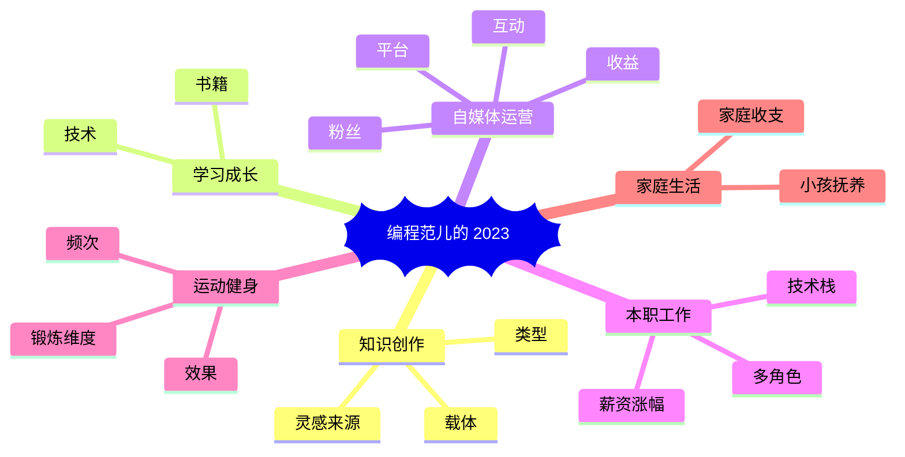

import { Main } from '@site/src/pages/progress';

<Main style={{ margin: '20px 0', borderRadius: '8px' }} config={{
  title: `${new Date().getFullYear()} 年度进度显示`,
  bgColor: 'linear-gradient(-44deg, #262626 0%, #4b4b4b 100%)',
  progressBarType: 'default',
  format: 'zh',
  copyright: false
}} />

2023年只剩下最后一周，又到了一年一度该做年末总结的时候了。

回想起去年，还有人专门建立了一个关于年度总结文章汇总的仓库。读了很多篇别人写的，给了我很多的触动和感想。这里的每篇文章都是关于某个人这一整年的生活和工作的轨迹啊。
即使你这一年过的再平凡，也能从别人的视角窥见一种完全不一样的生活图景。

仓库的地址：[https://github.com/saveweb/review-2022](https://github.com/saveweb/review-2022)，该仓库接受投稿。

所以想想今年还是下笔了~

下笔之前先来脑图下：

> 鉴于我的很多平台 ID 名为“编程范儿”，故以此代表本人

## 知识创作

其实对于程序员来说，Git 的提交记录无疑是这一年来自己的工作之余的代码和内容产出成功的有效说明：

### 载体

从图中可以看见从五月份开始，Git 的提交记录较之前突然有了明显的提升，原因主要在于 [spacexcode.com](https://spacexcode.com) 这个网站的搭建。至于为什么要创建这个网站，
前面也写过我对于建立这个网站的初衷和后续的持续工作计划。

- [x] [双节前把我的网站重构了一遍](https://spacexcode.com/blog/refactor-my-website)
- [x] [人生不必要精彩，但得有故事](https://spacexcode.com/blog/i-have-a-story)

这大半年以来，几乎每天都会将自己的所学到的一些经验、技术和感想形成文档记录下来。不管它能为你产生多大的效益，但最起码等到某个历史节点它能成为你参与互联网这个伟大时代的一点遗产。
或者为你的后代追溯你的生平提供一些历史资料信息。这样来看，还是值得好好坚持创作下去。

除了在这个网站上，我还有一个 [i-fanr.com](https://i-fanr.com) 站点，本着流量运营的角度去分享一些关于前端的零碎的知识点文章。目前保持每个月两三篇的频次。

语雀的小记和知识库会记录一些及时的所见所闻为写作积累素材。

自从年初买了第一个付费知识星球“池建强·让时间为你证明”，发现优质的东西包括信息总是有价值的。以后我会愿意为知识付费。

## 创作类型

以上都是以文字的形式来进行的创作，视频媒体近几年逐渐成为主流，我也不敢轻易忽视。视频号自从申请也没怎么更新，其实是我把视频定位为文字的辅助，它是另外的一种信息展示方式，比起文字更直接。
我一直有个思路，它来源于“卢克文”的创作模式，视频的脚本来自于他写的文章，然后通过拼接图片或已有的短视频形成画面的再次创作的形式。

或许 Markdown To Video 的技术可以帮助到我。

除了文字的形式，动态的演示网页也是我的创作形式之一。在这个网站上你会发现很多通过简单的配置来动态改变页面效果的地方，它能更直观的将一些知识特性演示给别人看。

### 创作的灵感来源

在社交媒体上关注一些行业的大佬，从他们的视角去发现一些新的资讯。

Github 更新后，首页的信息流也是有效的信息来源，伴随着推荐质量都很高。

其次，一定尽可能多的拓展自己的语言，然后尽可能大的拓展自己的信息渠道。中文互联网比起整个互联网毕竟是很小的一块。

## 自媒体运营

自媒体运营其实是一种逐渐放大自己 IP，然后获取收益的一种途径。

前期以知识分享为主，保持一种利他的心态，形成自己的影响力。

现在网站上放的一些 Google Adsense 平台的广告，也会以尽可能少的轻扰用户，保持好的阅读体验。公众号暂时不接受广告推广，分享一些优质的文章。依靠小频次的更新也带来的两三百精准粉丝的增长。
这是一个好的开始，我始终觉得粉丝不在多，而在于粘性。

网站和公众号的评论区也开始有一些互动和反馈。这是积累粉丝粘性的一个有效过程。

我是怎么平衡看待收益这个事？没有收益，你很难坚持下去，太看重收益你会比较急躁，难以产出优质的内容。所以运营好账号的同时偶尔去接一点广告是可以的。那怎么去接，如何让别人发现你？

当你的东西得到别人的认可的时候，自然会找上门来，就比如今年三四月份的时候，有人看中了 [i-fanr.com](https://i-fanr.com) 这个站的“[磁力](https://i-fanr.com/tag/%e7%a3%81%e5%8a%9b%e7%8c%ab/)”的关键词流量，
于是买了文章里的链接。就这样很突然地带来了一笔可观的收入。

## 学习与成长

学习与成长是每个人年终总结始终绕不过去的一个主题，作为一个技术打工人，为了不落后于整个行业背景，你总是需要主动地去学习新的技术和平时工作用不到但是能有效拓宽职业发展瓶颈的一些技术。
由于自己工作以来一直用的 Vue 框架，但是 React 你也很难不重视它在前端职业里的地位。

所以这个编程网站我选择了 Docusaurus 而不是 Vuepress。这是主动寻求改变和挑战的一种手段。你不会造桥，那你给桥先毁了。这样你不得不去重新造个桥。

还有为了不让自己仅仅局限在前端的思维里，后端你也要主动去学习，nextjs 是最近出来比较追捧的建站技术，我正在撰写关于它的实操的[专题](https://spacexcode.com/docs/topic/nextjs/intro)。

## 本职工作

这一年来，行业的大背景不容乐观，因此自己的心态上也始终抱有一丝的危机感。在无锡这样一个制造业发展的还比较好的城市，公司的发展目前来看还是稳步向前。

近几年是公司的大力发展的时候，人才和业务爆的发期，业务端会有大量的需求。前端的管理岗的空缺可以去争取争取。

而自己也将面临35岁大龄打工人的门槛，如何克服焦虑和职业晋升的压力会是下一年面临的挑战。

## 家庭生活

家庭生活方面，是我不愿意聊，但不聊好像又缺点什么。毕竟聊的年终总结还是全面具体点的比较好。

生活节奏方面参考我制作的页面：

[打造高效的生物钟](https://spacexcode.com/lifebalence)

> 世界上唯一公平的事是每个人一天24小时  
> 而如何度过这24小时，却有千万种方式  
> 选择什么样的生物钟，将决定你拥有什么样的人生

这是我近一两年来总结并践行的一个自认为比较健康的生活方式和节奏。未来会一直保持下去，只有拥有高效的生物钟，你才能活的自律和自由。

### 家庭开支

作为一个中年的“背贷人”，房贷会伴随着接下来的二十年，车贷明年下半年可以结束了。未来还会有什么贷暂时不知道。

虽然目前每个月会有盈余，但还是不敢花大钱。这一年感觉最大的就是生活成本上升了。

除了生活的零碎开支，近几年出门远游应该还是奢望。普通人真的只是在活着而已。如果想要更高质量的生活，就必须有新的收入来源。

### 抚养小孩

小孩子刚刚过了两周岁，见证了她成长的每个瞬间，这一年她的变化是最大的，几乎每个月都会学会新的技能。从走路的摇摇晃晃，到很平稳地奔跑。从一个字一个字的支支吾吾，到简单句子的大喊大叫，
会给你的生活添加惊喜。

当然累也是会有的，你的工作之余的生活会被她占满。突然性情的改变，无理取闹会让你手足无措。

总之有了孩子会大大改变你的生活节奏。苦乐掺杂，其中滋味任由你慢慢体会。这就是生活吧！

## 总结

2023年度关键词：成长、背贷、创作、生物钟、焦虑、收益。

