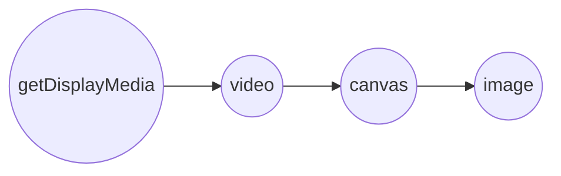

最近给[图片套壳美化工具](/screenshot)更新了两个重要的功能，简而言之就是：

1. 直接操作图片的放大缩小
2. 快速截图后上传图片（通过浏览器的 getDisplayMedia 接口）

**第一个功能**是为了方便操作，之前是在左侧通过滑动区块来调节图片区域的显示大小，不够直观或不方便实现更精细化的调节。

于是采用更常规的操作方式，在图片区域的四个角上新增操作手柄，当鼠标放在操作手柄上时，显示可拖拽的弧线。

<!--truncate-->

下图是对应的四个角的手柄位置和样式，和拖拽放大缩小的演示过程：

<video controls={true} src="https://spacexcode.oss-cn-hangzhou.aliyuncs.com/mp4/screenshot-update-log.mp4" width="100%" />

<br /><br />

关键代码

```jsx showLineNumbers
export default function Preview({ transform, showBtn }) {
  const [handSide, setHandSide] = useState('left');
  const [clientX, setClientX] = useState(0)

  // 是否在拖动
  const [isResizing, setIsResizing] = useState(false)

  const handleStartResize = useCallback((e, side) => {
    setHandSide(side)
    setIsResizing(true)
    setClientX(e.clientX)
  }, [])

  const handleStopResize = useCallback(() => {
    setIsResizing(false);
  }, [])

  const didHandleResize = debounce(e => {
    if (!isResizing) return;
    const offset = e.clientX - clientX;
    let scale = 0;
    const pixelToScale = 0.01;

    if (handSide === 'left') {
      scale = config.scale - offset * pixelToScale;
    }
    if (handSide === 'right') {
      scale = config.scale + offset * pixelToScale;
    }
    setClientX(e.clientX);
    handleConfigChange(parseFloat(scale.toFixed(2)), 'scale');
  }, 0)

  const handleResize = useCallback(didHandleResize, [isResizing, clientX, didHandleResize])

  useEffect(() => {
    document.addEventListener('mouseup', handleStopResize)
    document.addEventListener('mousemove', handleResize)

    return () => {
      document.removeEventListener('mouseup', handleStopResize)
      document.removeEventListener('mousemove', handleResize)
    }
  }, [handleStopResize, handleResize])
  
  return (
    <div className={styles.frameContent}>
      
      <div className={styles.displayContainer}>
        <div className={clsx(styles.mockupModule, styles[config.mockup.theme])} style={{ transform: transform, display: config.hideMockup ? 'none' : 'block' }}>
          <div className={styles.devices}>
            <div className={styles.item}>
              <div className={clsx(styles.itemContainer, 'item-container')}>
              { /*省略*/ }
              </div>
            </div>
            <div className={styles.resizeHandle}>
              <div className={clsx(styles.handleArea, styles.leftTop)} onMouseDown={e => handleStartResize(e, 'left')}>
                <div className={styles.handle} />
              </div>
              <div className={clsx(styles.handleArea, styles.rightTop)} onMouseDown={e => handleStartResize(e, 'right')}>
                <div className={styles.handle} />
              </div>
              <div className={clsx(styles.handleArea, styles.rightBottom)} onMouseDown={e => handleStartResize(e, 'right')}>
                <div className={styles.handle} />
              </div>
              <div className={clsx(styles.handleArea, styles.leftBottom)} onMouseDown={e => handleStartResize(e, 'left')}>
                <div className={styles.handle} />
              </div>
            </div>
          </div>
        </div>
      </div>
    </div>
  )
}
```

**第二个功能**是我从另一个工具上参考来的，因为我根本不知道浏览器上还能这么操作。

当调起 [navigator.getDisplayMedia](https://developer.mozilla.org/zh-CN/docs/Web/API/MediaDevices/getDisplayMedia) 这个接口的时候，
会弹起浏览器的系统弹窗：有三个可选项，分别是：Chrome 标签页，窗口，整个屏幕，选中某个界面进行分享之后，我们就能获取到对应的视频流。

弹窗效果如下图所示：


在 Web 中我们就可以通过创建 Video 标签将视频流渲染出来。最后怎么将视频转化为图片呢？熟悉 canvas 的不难，它有一个 drawImage 方法，可以将视频绘制在画布中。

最后我们将 canvas 对象通过 toDataURL() 方法转化为图片数据编码显示在 img 标签中。

`getDisplayMedia` 在不同浏览器下的兼容性处理：

```jsx showLineNumbers
function getDisplayMedia(options) {
  if (navigator.mediaDevices && navigator.mediaDevices.getDisplayMedia) {
    return navigator.mediaDevices.getDisplayMedia(options);
  }
  if (navigator.getDisplayMedia) {
    return navigator.getDisplayMedia(options);
  }
  if (navigator.webkitGetDisplayMedia) {
    return navigator.webkitGetDisplayMedia(options);
  }
  if (navigator.mozGetDisplayMedia) {
    return navigator.mozGetDisplayMedia(options);
  }
  throw new Error('getDisplayMedia is not defined');
}
```

通过 `getDisplayMedia` 获取到媒体流，然后在 DOM 中手动创建 `video` 标签，将媒体流渲染到视频组件中。然后从视频组件中截获某个帧，渲染到 `canvas`
中来，以 `drawImage` 接口的形式拿到最终的图片二进制文件。



```jsx showLineNumbers
async function takeScreenshotStream() {
  const width = screen.width * (window.devicePixelRatio || 1);
  const height = screen.height * (window.devicePixelRatio || 1);

  const errors = [];
  let stream;
  const mediaStreamConstraints = {
    audio: false,
    video: { width, height, frameRate: 1 }
  };

  try {
    stream = await getDisplayMedia(mediaStreamConstraints);
  } catch (ex) {
    errors.push(ex);
  }

  if (errors.length) {
    console.debug(...errors);
    if (!stream) {
      throw errors[errors.length - 1];
    }
  }

  return stream;
}

async function takeScreenshotCanvas() {
  const stream = await takeScreenshotStream();
  const video = document.createElement('video');
  const result = await new Promise((resolve, reject) => {
    video.onloadedmetadata = () => {
      video.play();
      video.pause();
      const canvas = document.createElement('canvas');
      canvas.width = video.videoWidth;
      canvas.height = video.videoHeight;
      const context = canvas.getContext('2d');
      context.drawImage(video, 0, 0, video.videoWidth, video.videoHeight);
      resolve(canvas);
    }
    video.srcObject = stream;
  })

  stream.getTracks().forEach(function (track) {
    track.stop();
  })

  if (result == null) {
    throw new Error('Cannot take canvas screenshot');
  }

  return result;
}
```

不过它有个小小的缺点，就是点击分享后会离开当前页面，导致整个操作不连贯。在用户不知道该特性的情况下使用的时候会有点迷惑。

不过这个功能还是大大简化了当你需要在其它页面或者窗口中截图来美化时，需要先隐藏当前窗口，然后手动调起截屏，选取截屏区域，保存截图后额外再点击上传图片。有了该功能，繁杂的流程简化了不少。

欢迎大家将使用过程中的问题反馈出来，助力我将这个工具做的越来越好用。为有图片美化和设备套壳需求的人带来便利。

