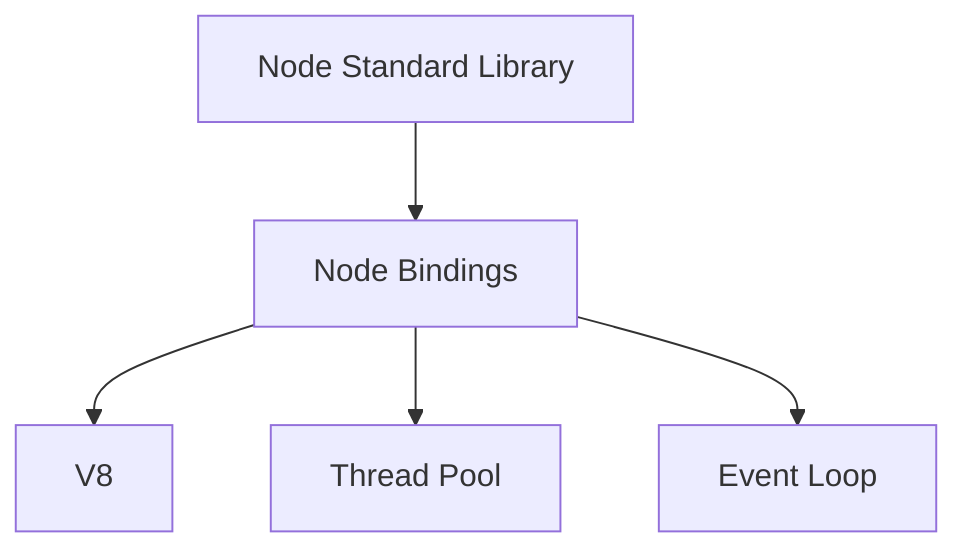

## 官方定义

Node.js® is a JavaScript runtime built on Chrome's V8 JavaScript engine. Node.js uses an event-driven, non-blocking I/O model that makes it lightweight and efficient. 
Node.js' package ecosystem, npm, is the largest ecosystem of open source libraries in the world.

从以上定义上可归纳为：

- Node.js 不是作为一门语言，而是 JavaScript 运行时环境而存在；
- 构建在主流的 JavaScript 引擎 `Chrome V8` 之上，底层采用 C/C++ 编写；
- 具有事件驱动（event-driven）、非阻塞 I/O 模型（non-blocking I/O model），及函数都是异步执行，最后由 `Libuv` 这个 C/C++ 编写的事件循环处理库来处理这些 I/O 操作，隐藏了非阻塞 I/O 的具体细节，
简化并发编程模型，让你可以轻松的编写高性能的Web应用，所以它是轻量（lightweight）且高效（efficient）的；
- 使用 `npm` 作为包管理器，目前 `npm` 是所有开源库里包管理最大的生态。

