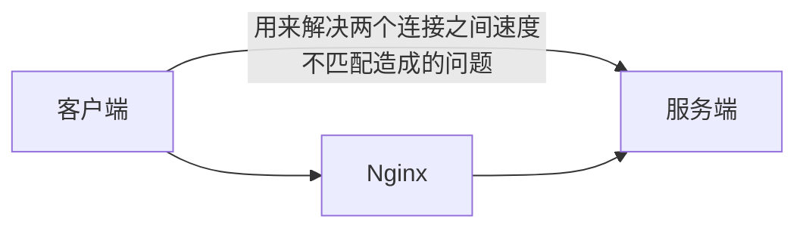

# Nginx Web 相关配置

Nginx（“engine x”）是一个高性能的 HTTP 和反向代理服务器，特点是占有内存少，并发能力强。  
官网地址：[http://nginx.org/](http://nginx.org/)

## 基础配置

```sh title=/etc/nginx/nginx.conf
user                            root;
worker_processes                1;
error_log /var/log/nginx/error.log;
pid /var/run/nginx.pid;

events {
  worker_connections            10240;
}

http {
  log_format                    '$remote_addr - $remote_user [$time_local] ' '"$request" $status $body_bytes_sent ' '"$http_referer" "$http_user_agent"';
  include                       mime.types;
  default_type                  application/octet-stream;
  sendfile                      on;
  #autoindex                    on;
  #autoindex_exact_size         off;
  autoindex_localtime           on;
  keepalive_timeout             65;
  gzip                          on;
  gzip_disable                  "msie6";
  gzip_min_length               100;
  gzip_buffers                  4 16k;
  gzip_comp_level               1;
  gzip_types                    text/plain application/x-javascript text/css application/xml text/javascript application/x-httpd-php image/jpeg image/gif image/png;
  gzip_types                    "*";
  gzip_vary                     off;
  server_tokens                 off;
  client_max_body_size          200m;

  server {
    listen                      80 default_server;
    server_name                 _;
    return                      403 /www/403/index.html;
  }

  include                       ../serve/*.conf;
}
```

## 隐藏 Nginx 版本信息

```sh
http {
  server_tokens         off;
}
```

## 禁止 ip 直接访问 80 端口

```sh
server {
  listen                80 default;
  server_name           _;
  return                500;
}
```

## 启动 Web 服务

```sh
server {
  # 项目启动端口
  listen            80;
  # 域名（localhost）
  server_name       _;
  # 禁止 iframe 嵌套
  add_header        X-Frame-Options SAMEORIGIN;
  
  # 访问地址 根路径配置
  location / {
    # 项目目录
    root 	    html;
    # 默认读取文件
    index           index.html;
    # 配置 history 模式的刷新空白
    try_files       $uri $uri/ /index.html;
  }
  
  # 后缀匹配，解决静态资源找不到问题
  location ~* \.(gif|jpg|jpeg|png|css|js|ico)$ { 
    root           html/static/;
  }
  
  # 图片防盗链
  location ~/static/.*\.(jpg|jpeg|png|gif|webp)$ {
    root              html;
    valid_referers    *.deeruby.com;
    if ($invalid_referer) {
      return          403;
    }
  }
  
  # 访问限制
  location /static {
    root               html;
    # allow 允许
    allow              39.xxx.xxx.xxx;
    # deny  拒绝
    deny               all;
  }
}
```

## 静态文件访问路径设置

```
location ~ .*\.(html|htm|gif|jpg|jpeg|bmp|png|ico|txt|js|css){  
  root   /soft/nginx/static_resources;
  # 过期时间
  expires 7d;  
}  
```

## PC端和移动端访问不同页面

```sh {6}
server {
  ...

  location / {
    root /home/static/pc;
    if ($http_user_agent ~* '(mobile|android|iphone|ipad|phone)') {
      root /home/static/mobile;
    }
    index index.html;
  }
}
```

## 一个项目里配置多个 Web 服务（比如微服务项目）

```sh
server {
  listen                80;
  server_name           _;
  
  # 主应用
  location / {
    root          html/main;
    index               index.html;
    try_files           $uri $uri/ /index.html;
  }
  
  # 子应用一
  location ^~ /store/ {
    proxy_pass          http://localhost:8001;
    proxy_redirect      off;
    proxy_set_header    Host $host;
    proxy_set_header    X-Real-IP $remote_addr;
    proxy_set_header    X-Forwarded-For
    proxy_set_header    X-Forwarded-For $proxy_add_x_forwarded_for;
  }
  
  # 子应用二
  location ^~ /school/ {
    proxy_pass          http://localhost:8002;
    proxy_redirect      off;
    proxy_set_header    Host $host;
    proxy_set_header    X-Real-IP $remote_addr;
    proxy_set_header    X-Forwarded-For $proxy_add_x_forwarded_for;
  }
  
  # 静态资源读取不到问题处理
  rewrite ^/api/profile/(.*)$ /(替换成正确路径的文件的上一层目录)/$1 last;
}

# 子应用一服务
server {
  listen                8001;
  server_name           _;
  location / {
    root          html/store;
    index               index.html;
    try_files           $uri $uri/ /index.html;
  }
  
  location ^~ /store/ {
    alias               html/store/;
    index               index.html index.htm;
    try_files           $uri /store/index.html;
  }
  
  # 接口代理
  location  /api {
    proxy_pass          http://localhost:8089;
  }
}

# 子应用二服务
server {
  listen                8002;
  server_name           _;
  location / {
    root          html/school;
    index               index.html;
    try_files           $uri $uri/ /index.html;
  }
  
  location ^~ /school/ {
    alias               html/school/;
    index               index.html index.htm;
    try_files           $uri /school/index.html;
  }
  
  # 接口代理
  location  /api {
    proxy_pass          http://localhost:10010;
  }
}
```

## 配置负载均衡

```sh
upstream my_upstream {
  server                http://localhost:9001;
  server                http://localhost:9002;
  server                http://localhost:9003;
}

server {
  listen                9000;
  server_name           spacexcode.com;

  location / {
    proxy_pass          my_upstream;
    proxy_set_header    Host $proxy_host;
    proxy_set_header    X-Real-IP $remote_addr;
    proxy_set_header    X-Forwarded-For $proxy_add_x_forwarded_for;
  }
}
```

## SSL 配置 HTTPS

```
server {
  listen                      80;
  server_name                 www.spacexcode.com;
  # 将 http 重定向转移到 https
  return 301 https://$server_name$request_uri;
}

server {
  listen                      443 ssl;
  server_name                 www.spacexcode.com;
  add_header Access-Control-Allow-Origin *;

  ssl_certificate             /etc/nginx/ssl/www.spacexcode.com.pem;
  ssl_certificate_key         /etc/nginx/ssl/www.spacexcode.com.key;
  ssl_session_timeout         10m;
  ssl_ciphers                 ECDHE-RSA-AES128-GCM-SHA256:ECDHE:ECDH:AES:HIGH:!NULL:!aNULL:!MD5:!ADH:!RC4;
  ssl_protocols               TLSv1 TLSv1.1 TLSv1.2;
  ssl_prefer_server_ciphers   on;
  
  location / {
    root                    /use/share/nginx/spacexcode;
    index                   index.html index.htm index.md;
    try_files               $uri $uri/ /index.html;
  }
}
```

## 开启资源压缩

```
http {
  # 开启压缩机制
  gzip on;
  # 指定会被压缩的文件类型(也可自己配置其他类型)
  gzip_types text/plain application/javascript text/css application/xml text/javascript image/jpeg image/gif image/png;
  # 设置压缩级别，越高资源消耗越大，但压缩效果越好
  gzip_comp_level 5;
  # 在头部中添加Vary: Accept-Encoding（建议开启）
  gzip_vary on;
  # 处理压缩请求的缓冲区数量和大小
  gzip_buffers 16 8k;
  # 对于不支持压缩功能的客户端请求不开启压缩机制
  gzip_disable "MSIE [1-6]\."; # 低版本的IE浏览器不支持压缩
  # 设置压缩响应所支持的HTTP最低版本
  gzip_http_version 1.1;
  # 设置触发压缩的最小阈值
  gzip_min_length 2k;
  # 关闭对后端服务器的响应结果进行压缩
  gzip_proxied off;
}
```

## 设置缓冲区

```
http {  
  proxy_connect_timeout 10;  
  proxy_read_timeout 120;  
  proxy_send_timeout 10;  
  proxy_buffering on;  
  client_body_buffer_size 512k;  
  proxy_buffers 4 64k;  
  proxy_buffer_size 16k;  
  proxy_busy_buffers_size 128k;  
  proxy_temp_file_write_size 128k;  
  proxy_temp_path /soft/nginx/temp_buffer;  
}
```

- `proxy_buffering`：是否启用缓冲机制，默认为 `on` 关闭状态
- `client_body_buffer_size`：设置缓冲客户端请求数据的内存大小
- `proxy_buffers`：为每个请求/连接设置缓冲区的数量和大小，默认 `4 4k/8k`
- `proxy_buffer_size`：设置用于存储响应头的缓冲区大小
- `proxy_busy_buffers_size`：在后端数据没有完全接收完成时，Nginx 可以将 `busy` 状态的缓冲返回给客户端，该参数用来设置 `busy` 状态的 `buffer` 具体有多大，默认为 `proxy_buffer_size * 2`。
- `proxy_temp_path`：当内存缓冲区存满时，可以将数据临时存放到磁盘，该参数是设置存储缓冲数据的目录
- `proxy_temp_file_write_size`：设置每次写数据到临时文件的大小限制
- `proxy_max_temp_file_size`：设置临时的缓冲目录中允许存储的最大容量
- 非缓冲参数项
  - `proxy_connect_timeout`：设置与后端服务器建立连接时的超时时间
  - `proxy_read_timeout`：设置从后端服务器读取响应数据的超时时间
  - `proxy_send_timeout`：设置向后端服务器传输请求数据的超时时间



## 解决跨域

```
location / {  
  # 允许跨域的请求，可以自定义变量$http_origin，*表示所有  
  add_header 'Access-Control-Allow-Origin' *;  
  # 允许携带cookie请求  
  add_header 'Access-Control-Allow-Credentials' 'true';  
  # 允许跨域请求的方法：GET,POST,OPTIONS,PUT  
  add_header 'Access-Control-Allow-Methods' 'GET,POST,OPTIONS,PUT';  
  # 允许请求时携带的头部信息，*表示所有  
  add_header 'Access-Control-Allow-Headers' *;  
  # 允许发送按段获取资源的请求  
  add_header 'Access-Control-Expose-Headers' 'Content-Length,Content-Range';  
  # 一定要有！！！否则Post请求无法进行跨域！  
  # 在发送Post跨域请求前，会以Options方式发送预检请求，服务器接受时才会正式请求  
  if ($request_method = 'OPTIONS') {  
    add_header 'Access-Control-Max-Age' 1728000;  
    add_header 'Content-Type' 'text/plain; charset=utf-8';  
    add_header 'Content-Length' 0;  
    # 对于Options方式的请求返回204，表示接受跨域请求  
    return 204;
  }
}
```

## 防盗链

防盗链的含义简而言之就是：禁止外部网站引入当前网站的资源对外展示。Nginx 可通过配置项 `valid_referers` 进行设置：

```
valid_referers none | blocked | server_names | string ...;
```

- `none`：表示接受没有 `Referer` 字段的 `HTTP` 请求访问。
- `blocked`：表示允许 `http://` 或 `https//` 以外的请求访问。
- `server_names`：资源的白名单，这里可以指定允许访问的域名。
- `string`：可自定义字符串，支配通配符、正则表达式写法

```
# 在动静分离的location中开启防盗链机制  
location ~ .*\.(html|htm|gif|jpg|jpeg|bmp|png|ico|txt|js|css){  
  # 最后面的值在上线前可配置为允许的域名地址  
  valid_referers blocked 192.168.12.129;  
  if ($invalid_referer) {  
    # 可以配置成返回一张禁止盗取的图片  
    # rewrite   ^/ http://xx.xx.com/NO.jpg;  
    # 也可直接返回403  
    return   403;
  }
    
  root   /soft/nginx/static_resources;  
  expires 7d;
}
```

## 相关工具

- 可视化的工具自动生成 NGINX 配置 - [https://www.digitalocean.com/community/tools/nginx?global.app.lang=zhCN](https://www.digitalocean.com/community/tools/nginx?global.app.lang=zhCN)
