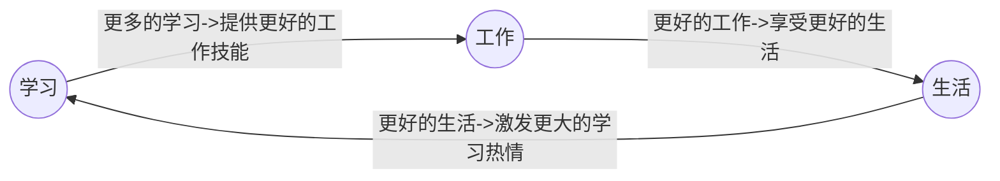

# 能力提升

:::tip 📚 深入阅读
- Thoughtworks 洞见 - [https://insights.thoughtworks.cn](https://insights.thoughtworks.cn)
- 产品沉思录 ProductThinking - [https://pmthinking.super.site](https://pmthinking.super.site)
:::

## 思维模式

### 纠正反馈循环

纠正反馈循环是一种思维方法，指的是在做任何事情的过程中，不断地检查自己的行为和结果，发现问题并及时改正，从而提高效率和质量。

纠正反馈循环的要点有以下几个：

- 明确目标和标准，知道自己想要达到什么样的效果。
- 实施行动计划，按照预定的步骤去执行。
- 评估结果和反馈，检查自己的行为是否符合目标和标准，收集别人对自己的评价和建议。
- 处理问题和改进，根据评估和反馈，找出自己的不足和错误，制定改进措施，并重新开始下一轮循环。

纠正反馈循环与正反馈循环有所不同。正反馈循环是指在做事情的过程中，得到积极的奖励或满足感，从而增强自己的动力和信心，继续做得更好。

纠正反馈循环更注重问题解决和持续改进，而正反馈循环更注重激励机制和心理状态。两者都是有益的思维方法，可以结合使用。

📍 **最佳践行者**：特斯拉、SpaceX 创始人[埃隆马斯克](https://zh.wikipedia.org/zh-cn/%E5%9F%83%E9%9A%86%C2%B7%E9%A9%AC%E6%96%AF%E5%85%8B)

### 延迟满足感

“延迟满足”概念，源自于沃尔特·米歇尔从1960年开始的一项名为“棉花糖实验”的儿童心理研究。研究人员在实验的孩子每人面前放一颗棉花糖，
并告知他们如果可以在20分钟内忍住不吃，则会获得第二颗糖。

这项试验的最终目标是在说明一个问题，自我控制不是单纯靠坚持或者说 “不”就可以实现的，而是要改变我们的思维方式，而这个思维模式就是“延迟满足”。

“延迟满足感”是指推迟或延迟满足某种欲望或需要，通常是为了获得更大的回报或更长期的满足感。这个概念强调了对即时满足的抵制，以便获得更好的结果或更长期的快乐。

延迟满足感通常需要自律和耐心，因为放弃即时的快乐或满足感可能会感到困难。然而，它可以帮助人们在未来实现更大的成功和幸福感。

专注、自控、追求长期价值，学会延迟满足，才能拥有选择的权利。

📍 **最佳践行者**：抖音创始人、字节跳动的 CEO [张一鸣](https://pmthinking.super.site/%E5%BC%A0%E4%B8%80%E9%B8%A3)

## 学习方法

### 卡片盒（Zettelkasten）笔记法

这种笔记法的两个特征：

- 做的笔记不是长篇大论，而是小到可以容纳在一张卡片中。
- 通过链接，将众多卡片连接起来，形成网状思考，组成结构化的文章。

通过这套方法改变了我一些固有的观念：

- 写作不是思考的结果，而是思考发生的媒介。写作可以很好地提高一个人的思维能力，因为它迫使你从更深的层次去阅读。
- 没有人会从零开始一件事情（也不要这样做），写文章也是，我们必须有平时收藏的素材，通过加工整理成一篇文章。
- 知识是互相连接的。且知识只有通过碰撞才产生新的知识的。知识一旦被分门别类地储存起来，往往意味着它的死亡。
- 建立一套标准化的方式来收集整理平时的笔记。通过标准化和简化笔记的格式和处理步骤，我们可以更聚焦在下面的流程：思考、反思、写作、讨论、测试和分享。 
- 多数时候我们都会陷入「收藏者谬误」，感觉收藏到就是学习到，但实际上「知晓某事」并不是「知道某事」。收藏更像是把信息搬运（而非加工），途中没有增加任何知识。

📍 **最佳践行者**： 德国的社会学家和系统理论家 [尼克拉斯 · 卢曼（Niklas Luhmann）](https://zh.wikipedia.org/zh-hans/%E5%B0%BC%E5%85%8B%E6%8B%89%E6%96%AF%C2%B7%E5%8D%A2%E6%9B%BC)

## 人生原则

### 长期主义

长期主义（Long-termism），指一种为了长期目标或结果而做决定的实践。

✔️ 长期主义为什么能有效，我认为有两个因素：

1. 从长期的视角看，事物总是向上发展的；
2. 长期来看，事物总会均值回归，就像我们抛硬币，随着次数的增多，概率会越来越趋近二分之一。

所以选择一个长期向上的方向，在足够长的时间里，拉平概率，在不确定的世界得到确定性的概率，就是我理解的长期主义。

❌ 避免认识误区：

1. 长期不等于时间长，事物的发展总是存在周期，而且还分为大周期和小周期，比如 10 - 20 年会经历一轮股市的牛熊周期，100 年 - 400 年
会经历一轮国家的兴衰更替，所以时间长不是重点，重点是需要能够识别周期性，能够穿越小周期，看透大周期。

2. 长期主义不等于无效坚持，选择一件毫无意义的事情坚持最终收获的效益微乎其微，所以要避免陷入无效的坚持中，长期主义需要在正确的方向坚持

### 极简主义

"极简主义" 是一种生活和思考的哲学，强调简化生活、减少物质和精神负担，专注于重要的事物。

✔️ 我认为极简主义最首要的原则：如无必要，勿增实体；若有必要，尽量选择最好的。

1. 世界总是向熵增的方向演进，总是向混乱的方向发展，所以为了保证可控性，需要保持极简，减少维护成本和潜在的负担；
2. 但如果确实是自己需要的东西，尽量选择最好的，价值越高，使用的时间也就越长。

❌ 避免认识误区：

1. 极简主义就是追求最少的东西。受到《断舍离》这本书的影响，外在的物品 = 物品本身 + 精力 + 时间 + 空间，所以拥有一个物品，还要拥有物品带来的一切。我开始不断的
扔东西，不断的简化自己生活需要的物品，这在一开始确实是正确的，扔掉不需要的物品之后确实能够减少负担，但也会导致在未来需要某样东西时，重复购买造成浪费。另一方面在我的东西已经
足够精简的时候，每当工作生活遇到不顺利的时候，还是会寻求扔东西带来的虚无满足感。

2. 极简主义只是物品极简。我沉迷于减少自己生活需要的物品，却忽略了其他方面的极简。杂乱的电子文档、混乱的目标规划和日程安排、没有章法的工作方式和决策方式、出于兴趣三分钟热度学习的课程，
这些都需要规划和删减。外在极简，内在混乱，不算是一个合格的极简主义者。

## 思考

学习、工作、生活之间的关系：

